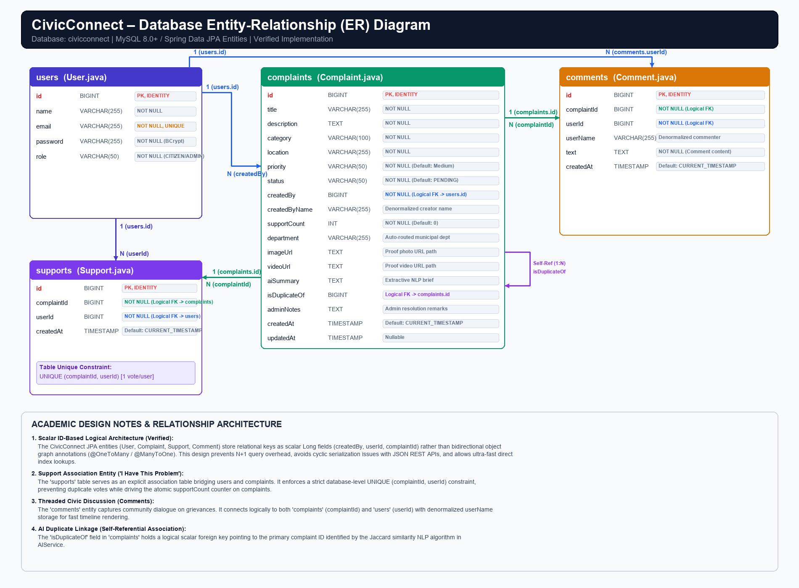
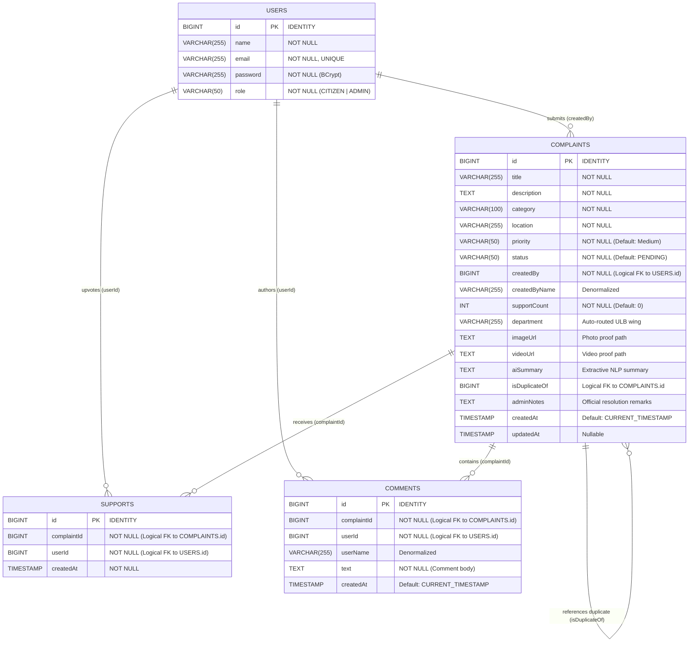

# Grievion Mission – Database Entity-Relationship (ER) Documentation
**AI-Powered Citizen Grievance Management System**  
> *“Every Grievance. A Step Toward Resolution.”*

---

## 1. Entity-Relationship (ER) Diagram

Below is the verified Entity-Relationship diagram for the `civicconnect` MySQL database, derived directly from the Spring Data JPA entities in the codebase (`User.java`, `Complaint.java`, `Support.java`, `Comment.java`).



### Mermaid Entity-Relationship Diagram


---

## 2. Entity Descriptions

### 1. `User` Entity (`users` table)
- **Class:** `com.civicconnect.entity.User`
- **Table Name:** `users`
- **Purpose:** Manages user accounts, authentication credentials, and role privileges across the platform.
- **Roles Supported:**
  - `CITIZEN`: Standard registered citizen who can submit complaints, attach multimedia proof, upvote public grievances, and participate in discussion threads.
  - `ADMIN`: Municipal grievance redressal officer with elevated administrative permissions (status transitions, administrative resolution remarks, department routing, and system analytics).

### 2. `Complaint` Entity (`complaints` table)
- **Class:** `com.civicconnect.entity.Complaint`
- **Table Name:** `complaints`
- **Purpose:** Core entity representing civic grievances, triage classifications, multimedia proof links, and administrative lifecycle statuses (`PENDING`, `IN_PROGRESS`, `RESOLVED`, `REJECTED`).

### 3. `Support` Entity (`supports` table)
- **Class:** `com.civicconnect.entity.Support`
- **Table Name:** `supports`
- **Purpose:** Serves as the association bridge table implementing the **"I Have This Problem"** community endorsement functionality. Enforces a strict one-vote-per-user-per-complaint policy.

### 4. `Comment` Entity (`comments` table)
- **Class:** `com.civicconnect.entity.Comment`
- **Table Name:** `comments`
- **Purpose:** Enables threaded citizen-official and citizen-citizen public discussions on individual grievances.

---

## 3. Primary Keys

All entities in CivicConnect use synthetic surrogate primary keys:
- **`users.id`**: `BIGINT` (Java `Long`), annotated with `@Id` and `@GeneratedValue(strategy = GenerationType.IDENTITY)` (MySQL `AUTO_INCREMENT`).
- **`complaints.id`**: `BIGINT` (Java `Long`), annotated with `@Id` and `@GeneratedValue(strategy = GenerationType.IDENTITY)`.
- **`supports.id`**: `BIGINT` (Java `Long`), annotated with `@Id` and `@GeneratedValue(strategy = GenerationType.IDENTITY)`.
- **`comments.id`**: `BIGINT` (Java `Long`), annotated with `@Id` and `@GeneratedValue(strategy = GenerationType.IDENTITY)`.

---

## 4. Important Fields & Schema Specifications

| Table | Field Name | Data Type | Constraints / Default | Description |
|---|---|---|---|---|
| `users` | `id` | `BIGINT` | `PK`, `AUTO_INCREMENT` | Unique user identifier |
| `users` | `name` | `VARCHAR(255)` | `NOT NULL` | Full name of citizen or admin |
| `users` | `email` | `VARCHAR(255)` | `NOT NULL`, `UNIQUE` | Login email address |
| `users` | `password` | `VARCHAR(255)` | `NOT NULL` | Salted BCrypt password hash |
| `users` | `role` | `VARCHAR(50)` | `NOT NULL` | Access role (`CITIZEN` / `ADMIN`) |
| `complaints` | `id` | `BIGINT` | `PK`, `AUTO_INCREMENT` | Unique grievance tracking ID |
| `complaints` | `title` | `VARCHAR(255)` | `NOT NULL` | Short summary of the grievance |
| `complaints` | `description` | `TEXT` | `NOT NULL` | Detailed description of the civic issue |
| `complaints` | `category` | `VARCHAR(100)` | `NOT NULL` | Civic domain (*Water, Roads, Electricity, etc.*) |
| `complaints` | `location` | `VARCHAR(255)` | `NOT NULL` | Street address, landmark, or ward name |
| `complaints` | `priority` | `VARCHAR(50)` | `NOT NULL`, Default: `'Medium'` | Urgency level (`CRITICAL`, `HIGH`, `MEDIUM`, `LOW`) |
| `complaints` | `status` | `VARCHAR(50)` | `NOT NULL`, Default: `'PENDING'` | Lifecycle state (`PENDING`, `IN_PROGRESS`, `RESOLVED`, `REJECTED`) |
| `complaints` | `createdBy` | `BIGINT` | `NOT NULL` | Scalar ID reference to filing user (`users.id`) |
| `complaints` | `createdByName` | `VARCHAR(255)` | Nullable | Denormalized creator name for fast rendering |
| `complaints` | `supportCount` | `INT` | `NOT NULL`, Default: `0` | Atomic community upvote counter |
| `complaints` | `department` | `VARCHAR(255)` | Nullable | Auto-routed or admin-assigned municipal wing |
| `complaints` | `imageUrl` | `TEXT` | Nullable | Public URL path to uploaded photo proof |
| `complaints` | `videoUrl` | `TEXT` | Nullable | Public URL path to uploaded video proof |
| `complaints` | `aiSummary` | `TEXT` | Nullable | Extractive 1–2 sentence NLP summary |
| `complaints` | `isDuplicateOf` | `BIGINT` | Nullable | Scalar ID reference to primary complaint |
| `complaints` | `adminNotes` | `TEXT` | Nullable | Official resolution notes from municipal admin |
| `complaints` | `createdAt` | `TIMESTAMP` | Default: `CURRENT_TIMESTAMP` | Grievance submission timestamp |
| `complaints` | `updatedAt` | `TIMESTAMP` | Nullable | Last status or resolution update timestamp |
| `supports` | `id` | `BIGINT` | `PK`, `AUTO_INCREMENT` | Unique support record ID |
| `supports` | `complaintId` | `BIGINT` | `NOT NULL` | Scalar reference to grievance (`complaints.id`) |
| `supports` | `userId` | `BIGINT` | `NOT NULL` | Scalar reference to voter (`users.id`) |
| `supports` | `createdAt` | `TIMESTAMP` | `NOT NULL` | Timestamp when upvote was recorded |
| `comments` | `id` | `BIGINT` | `PK`, `AUTO_INCREMENT` | Unique comment ID |
| `comments` | `complaintId` | `BIGINT` | `NOT NULL` | Scalar reference to grievance (`complaints.id`) |
| `comments` | `userId` | `BIGINT` | `NOT NULL` | Scalar reference to commenter (`users.id`) |
| `comments` | `userName` | `VARCHAR(255)` | Nullable | Denormalized commenter name |
| `comments` | `text` | `TEXT` | `NOT NULL` | Body of the public discussion comment |
| `comments` | `createdAt` | `TIMESTAMP` | Default: `CURRENT_TIMESTAMP` | Comment creation timestamp |

---

## 5. Logical Relationships & Cardinality

1. **`User` (1) ──── (N) `Complaint`**
   - **Relationship:** One user can submit zero or many complaints.
   - **Mapping:** `complaints.createdBy` logically references `users.id`.
   - **Ownership Rule:** Citizens can only edit or delete complaints where `complaint.createdBy == currentUser.id`.

2. **`User` (1) ──── (N) `Support`**
   - **Relationship:** One user can upvote multiple distinct complaints.
   - **Mapping:** `supports.userId` logically references `users.id`.

3. **`Complaint` (1) ──── (N) `Support`**
   - **Relationship:** One complaint can accumulate support from many citizens.
   - **Mapping:** `supports.complaintId` logically references `complaints.id`.

4. **`User` (1) ──── (N) `Comment`**
   - **Relationship:** One user can author multiple comments across complaints.
   - **Mapping:** `comments.userId` logically references `users.id`.

5. **`Complaint` (1) ──── (N) `Comment`**
   - **Relationship:** One complaint has an associated thread of multiple comments.
   - **Mapping:** `comments.complaintId` logically references `complaints.id`.

6. **`Complaint` (1) ──── (N) `Complaint` (Self-Referential Duplicate Link)**
   - **Relationship:** A complaint can be flagged by the AI duplicate detector as a duplicate of an existing primary complaint.
   - **Mapping:** `complaints.isDuplicateOf` logically references `complaints.id`.

---

## 6. Explanation of the Support Association ("I Have This Problem")

The `supports` table functions as an explicit **association entity (bridge table)** linking citizens to the grievances they endorse.

### Key Architectural Behaviors:
1. **Unique Constraint Enforcement:**
   In `Support.java`, the entity defines a table-level compound unique constraint:
   ```java
   @Table(
       name = "supports",
       uniqueConstraints = {
           @UniqueConstraint(columnNames = {"complaintId", "userId"})
       }
   )
   ```
   This guarantees at the database level that a citizen cannot submit multiple upvotes for the same complaint.
2. **Atomic Counter Synchronization:**
   When a user clicks "I Have This Problem", the backend checks if `SupportRepository.findByComplaintIdAndUserId(complaintId, userId)` exists:
   - If not present: Inserts a new `Support` record and increments `complaint.supportCount` by 1.
   - If already present: Deletes the existing `Support` record (toggle off) and decrements `complaint.supportCount` by 1.
3. **Performance Optimization:**
   Storing the aggregated `supportCount` directly on the `complaints` table eliminates the need for expensive `COUNT(*)` SQL aggregation queries during high-concurrency feed rendering.

---

## 7. Explanation of How Complaints and Comments are Connected

The discussion feature enables citizens and administrative officers to communicate directly on specific grievances:
1. When viewing a complaint modal, the frontend requests `GET /api/complaints/{id}/comments`.
2. The `CommentController` executes `CommentRepository.findByComplaintIdOrderByCreatedAtAsc(complaintId)`.
3. When a new comment is posted via `POST /api/complaints/{id}/comments`, the backend creates a `Comment` record storing:
   - `complaintId`: Identifies the target grievance.
   - `userId`: Identifies the author.
   - `userName`: Cached creator name (denormalized to avoid an extra join with `users`).
   - `text`: Comment content.
   - `createdAt`: Timestamp for chronological ordering.

---

## 8. Logical Relationships vs. Physical JPA Foreign Keys

### Actual Implementation in Source Code
In standard full-stack enterprise applications and microservices architectures, relationships can be modeled in two ways:
1. **Physical JPA Object Graph Associations:** Using `@OneToMany`, `@ManyToOne`, `@JoinColumn`, and holding object references (e.g., `private User user;`).
2. **Scalar ID-Based Logical Relationships:** Storing foreign IDs directly as scalar primitives (e.g., `Long createdBy`, `Long userId`, `Long complaintId`) and querying via Spring Data repository methods.

### Why CivicConnect Uses Scalar ID-Based Logical Relationships:
Inspect the actual source code (`Complaint.java`, `Support.java`, `Comment.java`):
- All foreign relationships are explicitly declared as scalar `Long` fields (`createdBy`, `userId`, `complaintId`, `isDuplicateOf`).
- **No `@ManyToOne` or `@OneToMany` annotations are present in the entity classes.**

### Advantages of This Design:
1. **Elimination of N+1 Query Problems:** Prevents Hibernate from executing recursive sub-queries when serializing lists of complaints.
2. **Zero Cyclic Serialization Recursion:** Avoids Jackson JSON infinite recursion errors (which typically require `@JsonIgnore` / `@JsonManagedReference` workarounds).
3. **Decoupled Architecture:** Allows lightweight data transfer objects (DTOs) and makes the system ready for distributed database partitioning or microservice extraction.
4. **Performance & Predictability:** Direct index-based lookups (`findByComplaintId`, `findByCreatedBy`) allow precise SQL query optimization and low memory footprint.

---
*Documentation verified for Grievion Mission against JPA entities in `com.civicconnect.entity`.*
