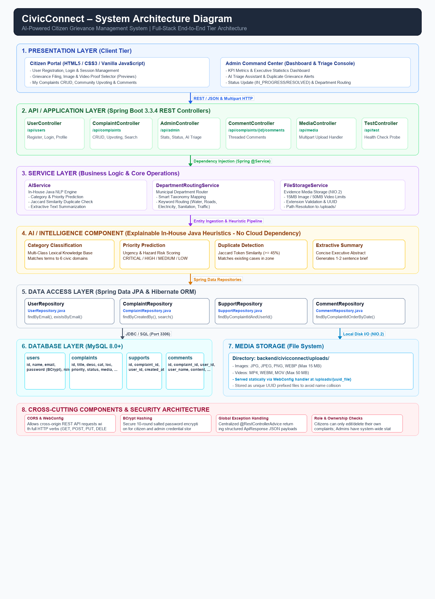

# CivicConnect – System Architecture Documentation
**AI-Powered Citizen Grievance Management System**

---

## 1. System Architecture Diagram

Below is the high-level tier architecture of CivicConnect, illustrating the interaction between the presentation layer, REST API controllers, business services, in-house AI intelligence components, JPA data access, relational storage, local media persistence, and cross-cutting components.



```
+===================================================================================================+
|                                    1. PRESENTATION LAYER                                          |
|  +---------------------------------------------+  +--------------------------------------------+  |
|  |                CITIZEN PORTAL               |  |           ADMIN COMMAND CENTER             |  |
|  | - Single-Page App (HTML5 / CSS3 / JS ES6+)  |  | - Municipal Dashboard & Real-Time Stats    |  |
|  | - Complaint Filing, Media Selector/Preview  |  | - AI Triage Panel & Duplicate Alerts       |  |
|  | - My Complaints CRUD, Upvoting, Comments    |  | - Status Transitions & Department Routing  |  |
|  +---------------------------------------------+  +--------------------------------------------+  |
+===================================================================================================+
                                                   |
                            HTTP / REST (JSON) & Multipart Form-Data
                                                   |
+===================================================================================================+
|                        2. API / APPLICATION LAYER (Spring Boot 3.3.4)                             |
|  +-------------------+  +---------------------+  +-------------------+  +----------------------+  |
|  |  UserController   |  | ComplaintController |  |  AdminController  |  |   CommentController  |  |
|  |    /api/users     |  |   /api/complaints   |  |    /api/admin     |  |  /api/complaints/... |  |
|  +-------------------+  +---------------------+  +-------------------+  +----------------------+  |
|  +--------------------------------------------+  +---------------------------------------------+  |
|  |              MediaController               |  |               TestController                |  |
|  |                /api/media                  |  |                 /api/test                   |  |
|  +--------------------------------------------+  +---------------------------------------------+  |
+===================================================================================================+
                                                   |
                                Spring Dependency Injection
                                                   |
+===================================================================================================+
|                                        3. SERVICE LAYER                                           |
|  +--------------------------------------------+  +---------------------------------------------+  |
|  |                 AIService                  |  |          DepartmentRoutingService           |  |
|  | - Category Classification & Priority Score |  | - Smart Municipal Taxonomy Router           |  |
|  | - Duplicate Detection & Extractive Summary |  | - Keyword-to-Department Routing Map         |  |
|  +--------------------------------------------+  +---------------------------------------------+  |
|  +---------------------------------------------------------------------------------------------+  |
|  |                                      FileStorageService                                     |  |
|  | - Multipart Validation (15MB Image / 50MB Video), UUID Naming, NIO.2 File Persistence       |  |
|  +---------------------------------------------------------------------------------------------+  |
+===================================================================================================+
                                                   |
+===================================================================================================+
|                  4. AI / INTELLIGENCE COMPONENT (In-House Java Heuristics)                        |
|  +-------------------------+  +-------------------------+  +--------------------------------+  |  |
|  | Category Classification |  |   Priority Prediction   |  |     Duplicate Detection        |  |  |
|  | Multi-class Lexical Map |  | Hazard & Urgency Score  |  | Jaccard Similarity (>= 45%)    |  |  |
|  +-------------------------+  +-------------------------+  +--------------------------------+  |  |
|  +------------------------------------------------------+  +--------------------------------+  |  |
|  |                  Extractive Summary                  |  |       Department Routing       |  |  |
|  |           Sentence-Level Abstract Generator          |  |  Automated ULB Wing Assignment |  |  |
|  +------------------------------------------------------+  +--------------------------------+  |  |
+===================================================================================================+
                                                   |
                                    Spring Data JPA Repositories
                                                   |
+===================================================================================================+
|                                     5. DATA ACCESS LAYER                                          |
|  +---------------------+  +-------------------------+  +--------------------+  +---------------+  |
|  |   UserRepository    |  |   ComplaintRepository   |  | SupportRepository  |  | CommentRepo   |  |
|  | Spring Data / HQL   |  |  Spring Data / HQL      |  | Spring Data / HQL  |  | Spring Data   |  |
|  +---------------------+  +-------------------------+  +--------------------+  +---------------+  |
|  +---------------------------------------------------------------------------------------------+  |
|  |                                Hibernate ORM & JDBC Connection                              |  |
|  +---------------------------------------------------------------------------------------------+  |
+===================================================================================================+
                         |                                                     |
               JDBC / SQL (Port 3306)                                Local File System (NIO.2)
                         |                                                     |
+================================================+   +==============================================+
|             6. RELATIONAL DATABASE             |   |              7. MEDIA STORAGE                |
|                  MySQL 8.0+                    |   |        backend/civicconnect/uploads/         |
|  - users        : Credentials & Roles          |   |  - Images: .jpg, .jpeg, .png, .webp (15MB)   |
|  - complaints   : Grievances & Status          |   |  - Videos: .mp4, .webm, .mov (50MB)          |
|  - supports     : Unique Community Upvotes     |   |  - Static Web Mapping: /uploads/**           |
|  - comments     : Public Discussion Threads    |   |  - UUID File Isolation                       |
+================================================+   +==============================================+
|                                                                                                   |
+===================================================================================================+
|                             8. CROSS-CUTTING COMPONENTS & SECURITY                                |
|  +-------------------------+  +-------------------------+  +-----------------------------------+  |
|  |   CORS & WebMvcConfig   |  |  BCrypt Password Hash   |  |     Global Exception Handler      |  |
|  | Open CORS & Static Map  |  | 10-Round Salted Hash    |  |   @RestControllerAdvice Handlers  |  |
|  +-------------------------+  +-------------------------+  +-----------------------------------+  |
|  +------------------------------------------------------+  +-----------------------------------+  |
|  |                Jakarta Bean Validation               |  |     Role & Ownership Guards       |  |
|  |       @Valid, @NotBlank, @Size Payload Validation    |  |  Citizen Ownership / Admin Control|  |
|  +------------------------------------------------------+  +-----------------------------------+  |
+===================================================================================================+
```

---

## 2. Description of Architecture Layers

### Layer 1: Presentation Layer (Client Tier)
The presentation layer is a responsive, single-page application built using pure **HTML5**, **CSS3**, and modern **Vanilla JavaScript (ES6+)**. It requires no heavy external frontend frameworks and is rendered directly inside standard web browsers.
- **Citizen Web Interface:** Provides citizen onboarding, account registration, credential authentication, grievance submission, live media file selection and preview, personal grievance management (edit/delete with ownership rules), community upvoting, and public discussion threads.
- **Admin Command Center:** Offers an executive municipal dashboard featuring live analytical KPI counters (Total, Pending, In Progress, Resolved), interactive filtering, AI-assisted triage evaluation, duplicate grievance notifications, department reassignment, and official status transition controls with resolution notes.

### Layer 2: API / Application Layer (Spring Boot REST)
Built on **Spring Boot 3.3.4**, this layer exposes well-structured RESTful endpoints consuming and producing `application/json` and accepting `multipart/form-data` uploads:
- **`UserController` (`/api/users`):** Handles citizen registration, login authentication, session validation, and profile retrieval.
- **`ComplaintController` (`/api/complaints`):** Manages the full lifecycle of grievances (creation, retrieval, search, user-specific filtering, updates, deletion, and support upvoting).
- **`AdminController` (`/api/admin`):** Provides aggregated municipal metrics, administrative status overrides, and AI triage inspections.
- **`CommentController` (`/api/complaints/{id}/comments`):** Exposes endpoints for reading and adding public discussion comments to complaints.
- **`MediaController` (`/api/media`):** Ingests photo and video evidence attachments.
- **`TestController` (`/api/test`):** Provides a lightweight health check probe for testing server availability.

### Layer 3: Service Layer (Business Logic & Core Operations)
The service layer encapsulates business rules, orchestration, and transactional workflows:
- **`AIService`:** Executes explainable text processing algorithms for classification, risk scoring, duplicate finding, and text summarization.
- **`DepartmentRoutingService`:** Translates grievance taxonomies and contextual keywords into designated municipal departments.
- **`FileStorageService`:** Enforces file format validation, file size limits (15MB for images, 50MB for videos), UUID-based unique filename generation, and disk I/O persistence via Java NIO.2.

### Layer 4: AI & Intelligence Component (Explainable In-House Java NLP)
CivicConnect employs a lightweight, deterministic in-house Java NLP engine that operates without external third-party cloud AI APIs:
- **Category Classification:** Evaluates token frequencies against categorized knowledge bases (Water, Roads, Electricity, Waste, Traffic, Sanitation).
- **Priority Prediction:** Scans for high-urgency keywords (e.g., *hazard*, *danger*, *hospital*, *sparking*, *burst*) to assign `CRITICAL`, `HIGH`, `MEDIUM`, or `LOW` priority levels.
- **Duplicate Grievance Detection:** Computes token-level **Jaccard Similarity** ($J(A, B) = \frac{|A \cap B|}{|A \cup B|}$) between newly submitted complaints and existing open complaints in the database. Submissions with $\ge 45\%$ similarity trigger duplicate alerts for administrators.
- **Extractive Summarization:** Formulates concise 1–2 sentence abstracts from lengthy citizen descriptions for fast administrative triage.
- **Department Routing:** Automatically assigns grievances to the appropriate municipal department (e.g., *Roads & Infrastructure*, *Water Supply & Drainage*, *Electrical & Power*).

### Layer 5: Data Access Layer (Spring Data JPA & Hibernate)
Provides an abstracted object-relational interface between Java domain entities and relational database tables:
- **`UserRepository`:** Provides CRUD and finder queries (`findByEmail`, `existsByEmail`).
- **`ComplaintRepository`:** Handles grievance filtering by author, status, category, and keyword searches.
- **`SupportRepository`:** Manages citizen upvotes with unique constraint enforcement.
- **`CommentRepository`:** Manages threaded comments chronologically.
- **Hibernate ORM:** Translates entity operations into SQL statements with automated schema management (`ddl-auto=update`).

### Layer 6: Relational Database (MySQL 8.0+)
Persistent storage layer managing data integrity and relational constraints:
- **`users`:** Stores citizen and administrative credentials (BCrypt hashed), roles (`ROLE_CITIZEN`, `ROLE_ADMIN`), and timestamps.
- **`complaints`:** Primary grievance records including title, description, category, priority, status, department, AI summary, support count, and media URLs.
- **`supports`:** Tracks citizen upvotes with a compound unique key `(complaint_id, user_id)`.
- **`comments`:** Contains public discussion messages linked to parent grievances.

### Layer 7: Media Storage (Local File System)
- **Root Directory:** `backend/civicconnect/uploads/`
- **Supported Formats:** Images (`.jpg`, `.jpeg`, `.png`, `.webp`) and Videos (`.mp4`, `.webm`, `.mov`).
- **Capacity Limits:** 15 MB per image file, 50 MB per video file.
- **Serving Mechanism:** Registered as static web resources via `WebConfig` and accessible at `http://localhost:8080/uploads/{uuid_filename}`.

### Layer 8: Cross-Cutting Components & Security
- **CORS Configuration:** Global cross-origin configuration in `WebConfig` allowing seamless communication between frontend clients and the backend.
- **Password Security:** Salted 10-round `BCryptPasswordEncoder` ensuring zero plain-text password persistence.
- **Global Exception Handling:** `@RestControllerAdvice` in `GlobalExceptionHandler` intercepting validation errors (`MethodArgumentNotValidException`) and server exceptions into uniform `ApiResponse` JSON envelopes.
- **Role & Ownership Protection:** Controller-level validation ensuring citizens can only modify or delete their own submissions while administrative actions require elevated roles.

---

## 3. Main Request / Data Flow

```
[ Citizen / Admin User ]
           |
           v
[ Web Browser (Chrome / Edge / Firefox) ]
           |
           v
[ HTML5 / CSS3 / JavaScript (script.js) ]
           |  (Submits Form via Fetch API)
           v
[ REST API / HTTP POST /api/complaints ]
           |
           v
[ ComplaintController ]
           |  (Invokes Services)
           v
[ AIService & DepartmentRoutingService ]
           |  (Computes AI Category, Priority, Summary, Duplicates, Department)
           v
[ ComplaintRepository (Spring Data JPA) ]
           |  (Generates SQL INSERT / UPDATE)
           v
[ Hibernate ORM / JDBC Driver ]
           |  (Executes Query over Port 3306)
           v
[ MySQL Database ("civicconnect") ]
```

---

## 4. AI Processing Flow

```
+-----------------------------------------------------------------------------+
|                            Grievance Submission                             |
|                  Title + Description + Category + Location                  |
+-----------------------------------------------------------------------------+
                                       |
                                       v
+-----------------------------------------------------------------------------+
|                                AIService                                    |
|                                                                             |
|  1. Text Normalization & Tokenization (Stop-word & Punctuation Stripping)   |
|                                       |                                     |
|  +------------------------------------+----------------------------------+  |
|  |                                    |                                  |  |
|  v                                    v                                  v  |
| [ Category Prediction ]     [ Priority Scoring ]     [ Extractive Summary ] |
| Matches keyword weights     Calculates risk &        Extracts first salient |
| against municipal taxonomy  urgency trigger terms    sentences (<=120 char) |
|                             (CRITICAL/HIGH/MED/LOW)                         |
|  |                                    |                                  |  |
|  +------------------------------------+----------------------------------+  |
|                                       |                                     |
|  2. Duplicate Matcher: Computes Jaccard Similarity vs Existing DB Cases     |
|     Similarity Index = |A ∩ B| / |A ∪ B|                                    |
|     Score >= 45% -> Sets Duplicate Flag & References Matching ID            |
+-----------------------------------------------------------------------------+
                                       |
                                       v
+-----------------------------------------------------------------------------+
|                         DepartmentRoutingService                            |
| Maps predicted category & context to responsible Municipal Department:      |
| (e.g., "Roads & Infrastructure", "Water Supply & Drainage", "Sanitation")   |
+-----------------------------------------------------------------------------+
                                       |
                                       v
+-----------------------------------------------------------------------------+
|                      Persist Enriched Grievance                             |
|          Saved to MySQL via ComplaintRepository with AI metadata            |
+-----------------------------------------------------------------------------+
```

---

## 5. Media Upload Flow

```
[ Citizen User ]
       |
       |-- 1. Selects Image (.jpg, .png, .webp) or Video (.mp4, .webm, .mov)
       v
[ Frontend File Input ]
       |
       |-- 2. Validates client-side extension & generates instant preview via URL.createObjectURL()
       |-- 3. Appends file to FormData payload
       v
[ HTTP POST /api/media/upload ]
       |
       v
[ MediaController ]
       |
       v
[ FileStorageService ]
       |-- 4. Verifies extension against allowed whitelist
       |-- 5. Enforces size boundaries (Image <= 15MB, Video <= 50MB)
       |-- 6. Generates unique filename: UUID + sanitized original filename
       |-- 7. Writes bytes to backend/civicconnect/uploads/ using Java NIO.2
       v
[ Return Public URL ]
       |-- 8. Returns JSON payload: { "fileUrl": "/uploads/{uuid_filename}" }
       v
[ Complaint Submission ]
       |-- 9. Frontend attaches fileUrl to imageUrl or videoUrl in ComplaintRequest
       v
[ WebMvcConfig Static Handler ]
       |-- 10. Allows public web streaming of evidence at http://localhost:8080/uploads/{uuid_filename}
```

---
*Documentation verified against the CivicConnect Spring Boot 3.3.4 & MySQL codebase.*
